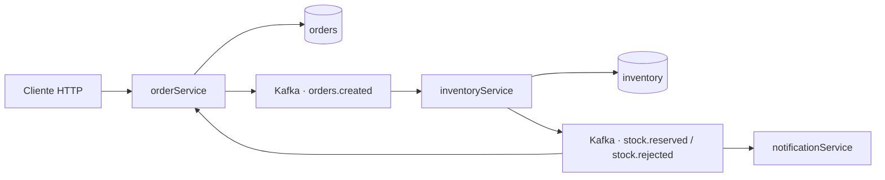

# Microservices Stock Project

[](https://github.com/adricarrera/MicroservicesStock/actions/workflows/ci.yml)

Sistema de pedidos y reservas de stock para una cadena de supermercados. La API registra cada pedido como `PENDING`. Inventario decide de forma asíncrona si puede reservar todas sus líneas y el pedido acaba como `CONFIRMED` o `REJECTED`. El proyecto explora la comunicación por eventos, la concurrencia y el procesamiento de mensajes duplicados.

**Tecnologías:** Java 21, Spring Boot 4, Spring Data JPA, Apache Kafka, PostgreSQL, Flyway, Docker Compose, JUnit, Testcontainers y GitHub Actions.

## Arquitectura

| Servicio | Responsabilidad |
| --- | --- |
| [orderService](orderService) | Expone la API REST, agrupa líneas por producto, guarda el pedido y aplica el resultado de la reserva. |
| [inventoryService](inventoryService) | Consume pedidos, comprueba el stock, registra el resultado y publica si la reserva se aceptó o se rechazó. |
| [notificationService](notificationService) | Consume el resultado y lo registra en logs como demostración de un consumidor independiente. |



Pedidos e inventario tienen bases lógicas separadas dentro de una instancia PostgreSQL local. Flyway aplica las migraciones al arrancar cada servicio y Hibernate valida el esquema. Kafka transporta eventos JSON con `orderId` como clave. Pedidos y notificaciones usan grupos de consumo distintos y cada uno recibe los resultados de inventario.

| Topic | Publica | Consumen | Efecto |
| --- | --- | --- | --- |
| `orders.created` | Pedidos | Inventario | Comprueba y procesa la reserva. |
| `stock.reserved` | Inventario | Pedidos y notificaciones | El pedido pasa a `CONFIRMED` y se registra el resultado en logs. |
| `stock.rejected` | Inventario | Pedidos y notificaciones | El pedido pasa a `REJECTED` y se registra el motivo en logs. |

## Arranque local

Necesitas **Java 21** y **Docker con Compose v2**. Desde la raíz, genera primero los JAR que copian los Dockerfiles.

**Windows (PowerShell)**

```powershell
foreach ($service in 'orderService', 'inventoryService', 'notificationService') {
    Push-Location $service
    try {
        .\mvnw.cmd --batch-mode -DskipTests package
        if ($LASTEXITCODE -ne 0) { throw "Falló la compilación de $service" }
    } finally {
        Pop-Location
    }
}
docker compose up --build -d
docker compose ps
```

**Linux o macOS**

```bash
for service in orderService inventoryService notificationService; do
  (cd "$service" && bash ./mvnw --batch-mode -DskipTests package) || exit 1
done
docker compose up --build -d
docker compose ps
```

La API escucha en `http://localhost:8080`. Espera a que Spring Boot confirme el arranque de los servicios en `docker compose logs -f order-service inventory-service notification-service`. Compose también publica PostgreSQL en `5432`, Kafka en `9092` e inventario en `8081`. Si hay un conflicto al arrancar, comprueba si esos puertos ya están ocupados.

Para parar el entorno, usa `docker compose down`. Los volúmenes conservan los pedidos y el stock entre ejecuciones.

## API y demo

| Método y ruta | Resultado |
| --- | --- |
| `POST /v1/orders` | Devuelve `201 Created` y el pedido en `PENDING`. |
| `GET /v1/orders/{id}` | Devuelve `200 OK` con el estado actual o `404 Not Found` si el pedido no existe. |

Flyway [precarga dos productos](inventoryService/src/main/resources/db/migration/V2__seed_products.sql). La demo usa el que empieza con 100 unidades en una base nueva. Ejecuta ambos bloques en la misma sesión de PowerShell.

### Pedido con stock

```powershell
$api = 'http://localhost:8080/v1/orders'
$productId = '3f2a9c1e-5b7d-4e8a-9c21-7d4e5f6a8b90'

function Wait-OrderStatus {
    param([string]$OrderUrl, [string]$ExpectedStatus)

    $deadline = (Get-Date).AddSeconds(30)
    do {
        $result = Invoke-RestMethod -Uri $OrderUrl -TimeoutSec 5
        if ($result.status -ne 'PENDING') {
            if ($result.status -ne $ExpectedStatus) {
                throw "Estado esperado: $ExpectedStatus. Estado recibido: $($result.status)."
            }
            return $result
        }
        Start-Sleep -Seconds 1
    } while ((Get-Date) -lt $deadline)

    throw "El pedido sigue en PENDING. Revisa los logs de pedidos, inventario y Kafka."
}

$body = @{ lines = @(
    @{ productId = $productId; quantity = 2 }
    @{ productId = $productId; quantity = 3 }
) } | ConvertTo-Json -Depth 4

$order = Invoke-RestMethod -Method Post -Uri $api -ContentType 'application/json' -Body $body
$order.lines
Wait-OrderStatus -OrderUrl "$api/$($order.id)" -ExpectedStatus CONFIRMED
```

La respuesta del POST contiene una sola línea con cantidad `5`. Con stock suficiente, el GET devuelve `CONFIRMED` después de que inventario procese la reserva.

### Pedido sin stock suficiente

```powershell
$body = @{ lines = @(
    @{ productId = $productId; quantity = 101 }
) } | ConvertTo-Json -Depth 4

$order = Invoke-RestMethod -Method Post -Uri $api -ContentType 'application/json' -Body $body
Wait-OrderStatus -OrderUrl "$api/$($order.id)" -ExpectedStatus REJECTED
```

El segundo pedido termina en `REJECTED` y conserva el stock disponible. Puedes ver ambos resultados con `docker compose logs notification-service`.

## Decisiones de implementación

- **Reserva completa.** Inventario comprueba la disponibilidad de todos los productos antes de descontar unidades. Si falta un producto o no hay stock suficiente, registra un rechazo sin aplicar un descuento parcial.
- **Concurrencia.** Inventario bloquea las filas de producto con un bloqueo pesimista de escritura y las consulta en orden de ID. Así dos reservas concurrentes para el mismo producto no pueden descontar sobre el mismo saldo inicial.
- **Idempotencia.** Inventario comprueba si ya existe una reserva para el pedido. La restricción `UNIQUE` sobre `stock_reservation.order_id` protege también ante dos intentos concurrentes. Pedidos solo admite transiciones desde `PENDING`, por lo que un evento repetido o contradictorio no cambia un estado final.
- **Líneas repetidas.** Pedidos suma las cantidades por `productId` antes de guardar y publicar el pedido. Inventario recibe la cantidad total de cada producto.

## Alcance actual

- **Consistencia entre PostgreSQL y Kafka.** Guardar el cambio y publicar el evento son operaciones separadas. Un fallo de publicación puede dejar un pedido en `PENDING`. Un outbox transaccional permitiría persistir el evento junto con el cambio y reintentar su publicación.
- **Validación de entrada.** La API agrupa las líneas por producto. Queda pendiente validar cantidades positivas, líneas obligatorias y el límite de la suma antes de guardar el pedido.

## Pruebas e integración continua

Con Docker activo, ejecuta `./mvnw verify` en cada directorio de servicio, o `.\mvnw.cmd verify` en PowerShell. Testcontainers levanta PostgreSQL para las pruebas de pedidos e inventario.

| Suite | Escenarios |
| --- | --- |
| `OrderServiceIntegrationTest` | Creación y consulta, pedido inexistente, agrupación de líneas, confirmación, rechazo y protección de estados finales. |
| `StockServiceIntegrationTest` | Reserva, stock insuficiente, producto inexistente, reservas concurrentes y mensajes duplicados, incluidos intentos concurrentes. |
| `NotificationServiceApplicationTests` | Arranque del contexto Spring de notificaciones. |

Pedidos e inventario prueban la persistencia con PostgreSQL real y sustituyen sus publicadores de Kafka. Las pruebas de pedidos invocan directamente el listener que aplica los resultados de la reserva. La demo permite comprobar manualmente la comunicación entre servicios a través de Kafka.

El [workflow de CI](.github/workflows/ci.yml) ejecuta Maven `verify` en tres trabajos paralelos con Java 21. Se activa en pull requests, pushes a `main` y ejecuciones manuales.

## Avance del proyecto

| Etapa | Evolución | Commits |
| --- | --- | --- |
| Base de pedidos | Conexión de Spring Boot a PostgreSQL en Docker, reorganización en un monorepo y modelado de `Order`, `OrderLine` y los estados del pedido. | `2f1d2c8`, `00f1e11`, `651fb5a` |
| API y persistencia | Repositorio JPA, servicio y controlador REST. Después llegaron la respuesta de error para pedidos inexistentes, las pruebas de integración, la migración inicial de Flyway y los ajustes de Maven y documentación. | `816c890`, `d38bf2e`, `396e4bf`, `01503e5` |
| Inventario y Kafka | Incorporación de Kafka a Compose, creación de la base de inventario y la tabla de productos, lógica de reserva y pruebas de stock. Pedidos empezó a publicar `OrderCreated` y Flyway añadió datos de ejemplo. | `f4eaca7`, `455bc5e`, `d9c584a`, `8f833be`, `f6d9e13` |
| Flujo asíncrono | Inventario pasó de recibir `OrderCreated` a ejecutar la reserva. Luego publicó el resultado y pedidos empezó a consumirlo. Los refactors trasladaron las decisiones de negocio a los servicios y dejaron los listeners como puntos de entrada de Kafka. | `6b31924`, `93f2bf8`, `a2d2696`, `06da333`, `cccb601` |
| Concurrencia y estados | Bloqueo de productos y pruebas concurrentes, consumidor de notificaciones, registro único de reserva por pedido y protección de las transiciones de estado ante eventos duplicados o contradictorios. | `27daf20`, `ce65a99`, `e995c96`, `87adcc5` |
| Entorno reproducible | Primeros Dockerfiles de inventario y notificaciones, seguidos del Dockerfile de pedidos y la configuración conjunta de los tres servicios, PostgreSQL y Kafka en Compose. | `00e2f77`, `b015dd3` |
| Agrupación y CI | Unificación de líneas por producto con su prueba, incorporación de GitHub Actions y retirada de los dos `contextLoads` que intentaban usar PostgreSQL local en CI. Se añadió un mock del publicador de pedidos para eliminar la dependencia de Kafka en esa suite. | `eaaca23`, `9aa2e93`, `6bb7a59`, `ec5ff3e` |
